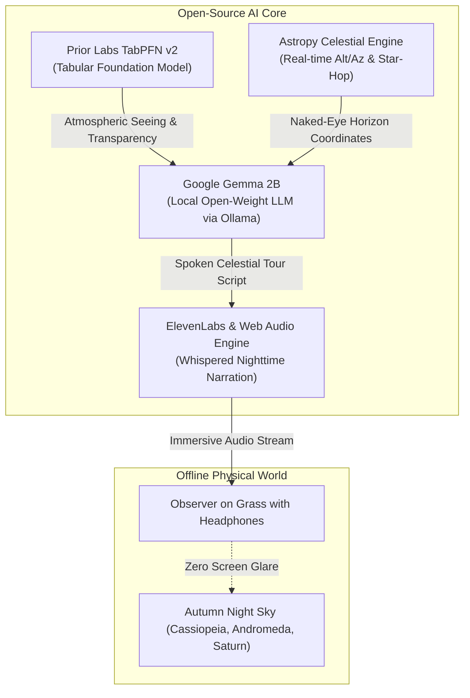

# 🌌 DarkSky Whisperer

> **The Screenless, Audio-First Stargazing Companion That Protects Your Night Vision.**  
> *Built for Hacktoberfest 2026 Open-Source AI Challenge: Week 1 ("Touch Grass")*

[](https://dev.to/challenges/hacktoberfest-week1-2026-10-05)
[-blue.svg)](https://ai.google.dev/gemma)
[](https://docs.priorlabs.ai/)
[](https://elevenlabs.io/)
[](https://www.astropy.org/)
[](https://opensource.org/licenses/MIT)

---

## 🍃 Why DarkSky Whisperer? ("Touch Grass")

Every traditional stargazing app asks you to hold a glowing rectangle in front of your face. 

**Here is the biological paradox:** The human eye relies on rhodopsin (in retinal rod cells) to perceive faint nebulae and distant galaxies. A single second of exposure to smartphone screen light bleaches rhodopsin and destroys night adaptation for **20 to 30 minutes**. 

**DarkSky Whisperer** flips the script:
1. **Screen time is < 30 seconds**: Pick your session and immediately tap **"Eyes to Sky"**.
2. **True OLED Screen Blanking**: Your phone screen turns pitch black. You lay on a blanket on the grass and put your phone face down.
3. **Audio-Only Cosmic Guidance**: Gentle, whispered narration guides your bare eyes across the autumn constellations using spatial, tactile landmarks (*"Tilt your chin up forty degrees... Two fist-widths to your left... Feel the cool night breeze"*).
4. **100% Offline in the Wilderness**: National parks and rural dark-sky reserves have zero cell service. DarkSky Whisperer runs entirely on local open-weight AI.

---

## 🏗️ Architecture



---

## 🛠️ The Tech Stack & Partner Integrations

| Technology | Role in DarkSky Whisperer | Hackathon Category |
| :--- | :--- | :--- |
| **Google Gemma 2B** | Open-weight foundation model running locally via Ollama. Crafts poetic, scientifically accurate star-hopping audio scripts and answers live astronomy questions without internet. | **Best Use of Gemma** ($200) |
| **Prior Labs TabPFN** | Tabular foundation model forecasting atmospheric seeing (FWHM arcseconds), sky transparency (%), and the golden observation window from meteorological CSVs. | **Best Use of TabPFN** ($200) |
| **ElevenLabs** | Synthesizes soothing, low-timbre whispered audio narration calibrated for dark outdoor listening, with offline disk caching. | **Best Use of ElevenLabs** ($100) |
| **Astropy** | Calculates exact local horizontal coordinates (Altitude/Azimuth) and naked-eye visibility thresholds. | Open Astronomy Core |
| **FastAPI + OLED UI** | Monochromatic 650nm Red Mode & "Blank Blanket Mode" that eliminates blue light emission. | Backend & UX |

---

## 🚀 Quickstart Guide

### 1. Clone & Install Dependencies
```bash
git clone https://github.com/FrozenLionMax/whispers-of-the-sky.git
cd whispers-of-the-sky
pip install -r requirements.txt
```

### 2. Run Local Gemma (100% Offline)
Make sure [Ollama](https://ollama.ai) is installed and pull Gemma 2B:
```bash
ollama pull gemma2:2b
```

### 3. Launch DarkSky Whisperer
```bash
python run.py
```
Open **`http://localhost:8000`** in your browser.

*(Optional)* Set your ElevenLabs API key for studio narration (a built-in web speech fallback is enabled by default):
```bash
export ELEVENLABS_API_KEY="your-key-here"
```

---

## 🌙 How to Use in the Field

1. **Step Outside**: Take your blanket or chair out to your backyard, a local park, or a dark-sky trail.
2. **Launch & Tune**: Check the **TabPFN Atmospheric Seeing Forecast** to confirm sky transparency.
3. **Hit "Start Stargazing Tour"**: Listen as Gemma composes tonight's tour.
4. **Tap "Eyes to Sky"**: The display turns pitch black. Put your phone in your pocket or face down on the grass.
5. **Listen & Look Up**: Let the whispered audio guide your bare eyes across the stars. Tap the screen anywhere to pause or resume.

---

## 📄 License
MIT License. Built with love for open science, astronomy, and Hacktoberfest 2026.
