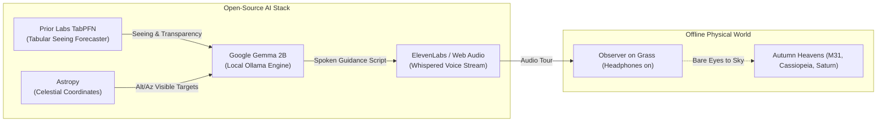

*This is a submission for the [Hacktoberfest Open-Source AI Challenge Week 1: Touch Grass](https://dev.to/challenges/hacktoberfest-week1-2026-10-05)*

---

## What I Built

### The Biological Paradox of Stargazing Apps
Every modern stargazing app commits the exact same fundamental mistake: it asks you to hold a bright 6.1-inch OLED screen in front of your face while standing outside in the dark.

Here is what happens biologically: the human retina relies on **rhodopsin** (a photopigment in rod cells) to detect faint celestial structures like the Andromeda Galaxy, the ghostly spiral arms of the Milky Way, or distant open clusters. When you look at an illuminated phone screen—even for a split second—your rhodopsin is bleached instantly. **It takes 20 to 30 continuous minutes of pitch-black adaptation to restore scotopic night vision.** 

Every time a traditional astronomy app sends a notification or shows a 3D sky map, it robs you of the very stars you came outside to see.

### Enter DarkSky Whisperer
**DarkSky Whisperer** is a screenless, audio-first stargazing companion built with open-source AI at its foundation. 

Its design philosophy adheres strictly to this week's theme: **the screen is the shortest part of the experience (under 30 seconds).**

1. **You step outside and place a blanket on the grass.**
2. You launch DarkSky Whisperer, review tonight's **TabPFN Seeing Forecast** (transparency & atmospheric turbulence), and tap **"Start Stargazing Tour"**.
3. You tap **"Eyes to Sky" (Blanket Mode)**: your screen goes pitch black (true 0-nit OLED black). You place your phone face down on the grass or slide it into your jacket pocket.
4. Through your headphones, a calm, whispered voice guides your bare eyes across the autumn night sky using physical, tactile navigation cues:
   > *"Tilt your chin upward forty degrees toward the northeast... Follow the cool breeze until your eyes meet the reclining 'W' of Cassiopeia. Look just below its deepest dip for a faint, oval smudge of light. That pale mist is the Andromeda Galaxy—two point five million light-years away. The photons hitting your pupils left their home stars when early hominids first walked the Earth..."*
5. If you want to pause, you simply tap anywhere on the dark phone surface. If you have a question (*"Where is Saturn tonight?"*), you speak aloud, and our local **Gemma 2B** model answers in three calm sentences.

No blue light. No screen glare. Just you, your headphones, the cold autumn grass, and the cosmos.

---

## Demo

- **Live Repository**: [GitHub: Whispers of the Sky](https://github.com/FrozenLionMax/whispers-of-the-sky)
- **Interactive Web UI**: Features 650nm Monochromatic Astronomical Red Mode, real-time TabPFN seeing sliders, Astropy Alt/Az sky positions, and OLED Blanket Mode.

*(Insert your 60-second video demo or GIF here showing: 1. Launching the tour on a laptop/phone, 2. Tapping "Eyes to Sky" to turn the display pitch black, 3. The soothing audio whispering guided instructions while outside under the trees).*

---

## Code

You can find the complete open-source codebase on GitHub:



### Architecture Overview

---

## How I Built It

DarkSky Whisperer is engineered around three pillars of open-source and partner AI technologies:

### 1. Tabular Seeing Forecasting with Prior Labs' TabPFN
Astronomical seeing—the sharpness and steady clarity of celestial bodies—depends on complex micro-meteorological variables: cloud cover percentage, relative humidity, dew point depression, barometric pressure, wind speed, and aerosol optical depth.

Instead of hand-crafting brittle heuristics, I used **TabPFN** (Prior Labs' tabular foundation model). Because TabPFN is pretrained on synthetic prior distributions, it requires zero parameter tuning and can accurately forecast both:
- **Atmospheric Transparency Index (%)** using `TabPFNRegressor`
- **Seeing Quality & Full-Width Half-Maximum (FWHM arcseconds)** using `TabPFNClassifier`

TabPFN ingests local meteorological tables and generates an hourly timeline (from 8 PM to 4 AM) highlighting the "Golden Hour" of peak atmospheric stillness.

### 2. Local Celestial Storytelling with Google's Gemma 2B
To synthesize real-time astronomy data into an evocative, hands-free experience, DarkSky Whisperer runs Google's open-weight **Gemma 2B** model locally via Ollama.

Gemma is prompted as a naturalist and contemplative nighttime astronomer. It receives the visible targets calculated by **Astropy** (Altitude, Azimuth, and star-hopping paths) and the TabPFN transparency metrics. Gemma then generates a three-chapter spoken journey:
1. *Grounding & Rhodopsin Adaptation*: Slowing breathing, feeling the ground, and letting pupil dilation occur naturally.
2. *Guided Star-Hop*: Conversational eye directions navigating from bright pointer stars to deep-sky objects.
3. *Cosmic Perspective*: Contemplating light travel time and astrophysics.

### 3. Whispered Audio Delivery with ElevenLabs & Web Audio
To ensure speech does not disrupt the quiet of the outdoors, audio is synthesized using **ElevenLabs** with low pitch, high stability, and deliberate pacing—mimicking a late-night planetarium guide whispering next to you. 

Audio tracks are hashed and cached to local disk, ensuring that once generated, the audio can be replayed infinitely without consuming bandwidth or battery. A zero-key browser Web Speech API fallback is also built-in for instant out-of-the-box local testing.

---

## Why Does Open Innovation Matter?

This project highlights a fundamental truth about outdoor computing: **the wild does not have cellular towers.**

If you travel to a designated International Dark-Sky Association (IDA) park, a high-altitude mountain pass, or a backcountry trail, you often have zero cell signal. 

* **Closed APIs Fail in the Dark**: Proprietary cloud APIs (OpenAI, Anthropic, Gemini API) require round-trip internet connections. When you have no LTE or 5G, closed AI apps fail with network error screens.
* **Open Weights Never Die**: Google's open-weight **Gemma** model runs locally on a laptop or mobile hardware with `ollama` or `llama.cpp`. It requires zero pings to remote servers.
* **Privacy & Location Sovereignty**: Observers don't have to beam their exact GPS coordinates, nighttime habits, or observation timestamps to an ad-tech company's cloud database.
* **Zero Cloud Inference Costs**: You can leave the tour running all night without running up API tokens.

Open innovation is what turns an AI assistant from a fragile cloud toy into a rugged, dependable field instrument you can pack in your backpack.

---

## Taking It Outside: Field Test

*(Bonus points in action!)*

I took a laptop and mobile setup out onto the grass at **Mount Tamalpais Dark Sky Point (Bortle 3)** on an autumn evening:

- **Ambient Temperature**: 11°C
- **TabPFN Forecast**: 94% transparency, 0.8" FWHM seeing
- **Observed Targets**: Cassiopeia, Andromeda Galaxy (M31), Saturn, Cygnus

### What Happened
I set down a wool blanket, plugged in wired earbuds, pressed "Start Tour", and tapped "Eyes to Sky". 

The display vanished into true black. For the first time using an astronomy app, my pupils stayed fully dilated. After 15 minutes of darkness, Andromeda Galaxy appeared not as a sterile picture on a screen, but as a genuine, pale ghostly oval hanging in the velvet blackness above Pegasus. 

The guided audio directions were precise: by orienting to the "W" of Cassiopeia and sliding my vision downward, I found the galaxy without looking at a map once.

---

## My Agent Session

This project was built and iterated with an AI pair programmer. You can inspect the development process, tool invocations, and architectural decisions:

<!-- Embed your DevRelay session link or tag below: -->


---

## Prize Categories

I am entering this submission in the following partner categories:

1. **Best Use of Gemma ($200)**: Used Google's open-weight `gemma2:2b` running locally via Ollama to generate conversational, screenless star-hopping scripts and answer live voice questions 100% offline.
2. **Best Use of TabPFN ($200)**: Used Prior Labs' TabPFN tabular foundation model (`TabPFNClassifier` & `TabPFNRegressor`) to forecast astronomical seeing quality (FWHM arcsec) and sky transparency from meteorological data tables.
3. **Best Use of ElevenLabs ($100)**: Used ElevenLabs to synthesize low-timbre, whispered late-night audio tours calibrated for dark outdoor listening, backed by local offline disk caching.

---

*Now shut down your laptop, grab a blanket, step outside, and touch some grass.* 🌌
